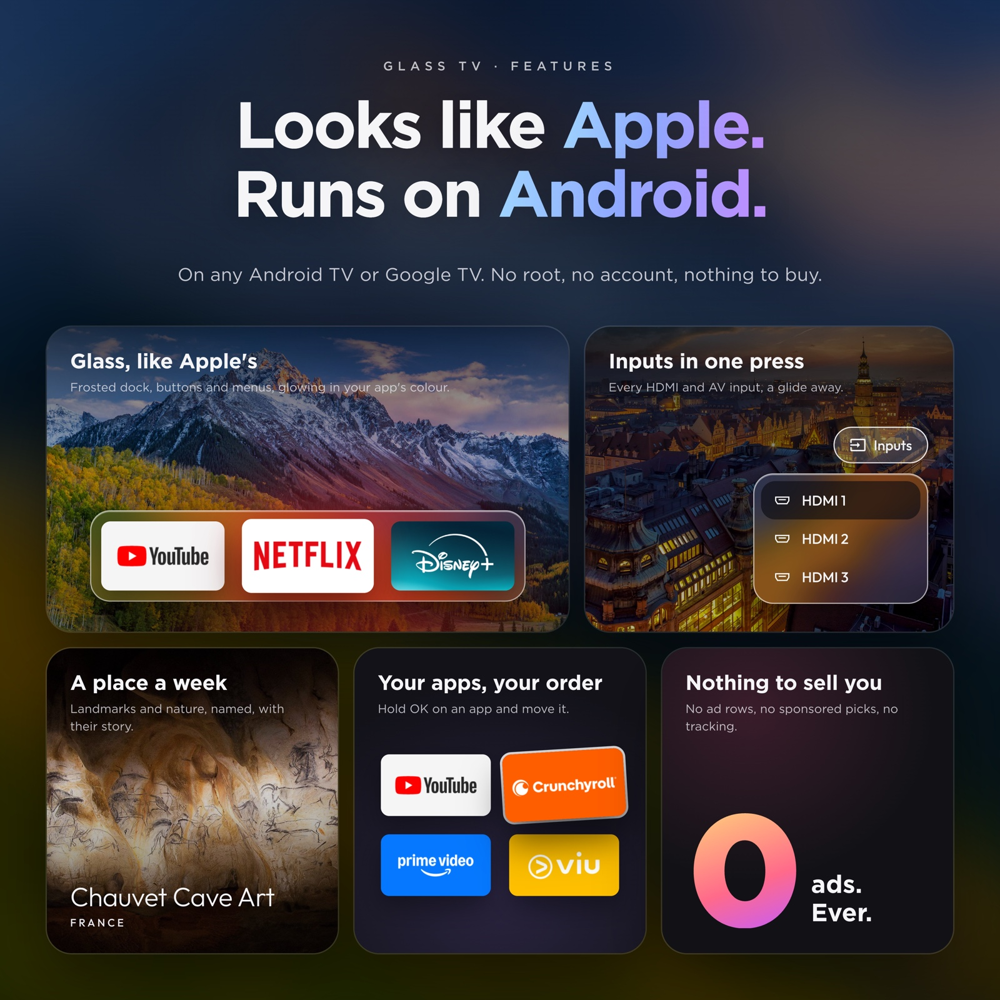
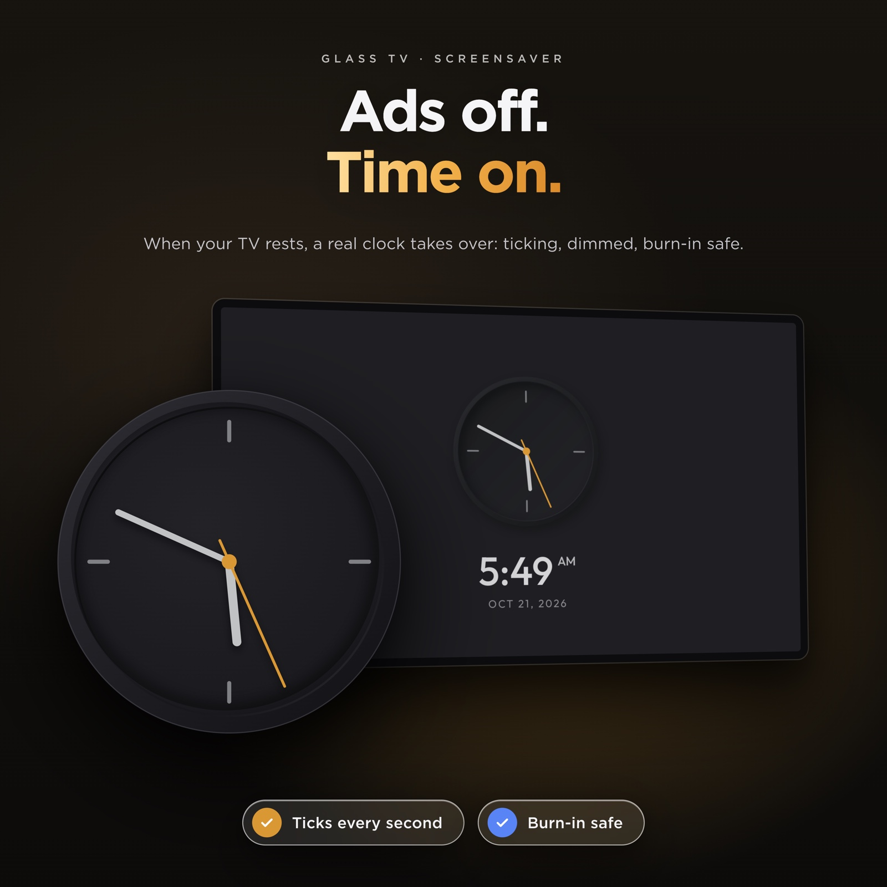
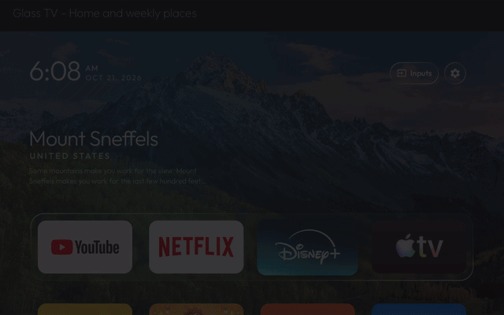

# Glass TV

**ReamyNadzri's Glass TV** adds app zoom animations, JAKIM prayer times, settings you control
from the remote, and a glass frame around the selected app to a lightweight Android TV home screen.

[](https://github.com/ReamyNadzri/glass-tv/actions/workflows/ci.yml)
[](LICENSE)

## New Android TV features in this version

- **App opening and return animations.** Choose Card, Glass, Lift, Stretch or Off, with Slow,
  Normal and Fast speeds. Returning from an app reverses the animation back into its tile.
- **JAKIM Waktu Solat widget.** Show prayer times in a glass card, top-bar pill or dock strip,
  with a countdown and optional reminders on Home. Pick a prayer zone or let the TV's location
  choose it; the month's times are cached on the TV.
- **Settings directly from the remote.** Change animation style and speed, calm or lively motion,
  prayer layout and zone, reminders, and the Wi-Fi button from the Glass TV settings panel.
  Saved choices take precedence over theme defaults.
- **Selectable glass focus frame.** A visible glass border surrounds the selected app by default;
  switch to the subtler selection in settings if you prefer.

**Make your Android TV or Google TV fast and ad-free again: strip out the bloat and ads, free up memory,
and come home to just your apps, with a new place to visit behind them every week.**

Glass TV debloats any Android TV or Google TV over Wi-Fi, with no root and nothing that can't be undone, then
swaps the ad-filled home screen for a light one in frosted glass, with a new set of places behind your apps
every week.

<p>
  
  
  
</p>

## Video tour

[](https://raw.githubusercontent.com/ReamyNadzri/glass-tv/main/docs/media/glass-tv-tour.mp4)

[Watch or download the 16-second MP4](https://raw.githubusercontent.com/ReamyNadzri/glass-tv/main/docs/media/glass-tv-tour.mp4).
This is a silent tour made from the included screenshots; it shows the screens rather than live remote interaction.
See [media credits](docs/media/README.md).

## What you get

- **Keeps itself clean.** Every 15 days, while Home sits idle, the TV clears its app caches, where the Play
  Store leaves gigabytes of download leftovers that can make apps open to a blank screen. No computer needed,
  sign-ins and app data are never touched; the TV asks once to allow it.
- **Glass, like Apple's.** The dock's tray, the top-bar buttons and the menus show the picture behind them
  softened, with a shine along their edges. Android 10 has no live blur, so the picture is blurred once each
  time it changes and the glass draws its patch of it.
- **One selection that glides.** Between apps it is a pane of glass with the app's shadow under it; on the top
  bar and in the menus it is dark. It glides and changes shape from one to the next, never jumps.
- **Apps zoom open, like on Apple TV.** OK grows the tile's colour until it fills the screen with the app's
  picture sharp in the middle, Home pushing in and darkening behind it, and the app fades in over it. Coming
  back, it shrinks into its place while Home settles back. Card, Glass, Lift, Stretch or Off, at three speeds.
- **Waktu solat.** Today's prayer times from JAKIM in a glass card, a top-bar pill or a strip above the dock,
  with a countdown to the next one and an optional reminder on Home. The zone comes from the TV's location or
  is picked from JAKIM's list; the month is fetched once and kept on the TV.
- **Its own settings, from the remote.** The Glass TV tile at the end of the apps opens a glass panel: the
  opening animation and its speed, calm or lively motion, the waktu solat widget, its zone and reminder, and
  the Wi-Fi button. Left and Right change a row; what you choose wins over the theme.
- **Places to visit that renew themselves.** Once a week the TV takes the pictures Bing has shown on its home
  page over the past days — landmarks, landscapes, wildlife — deletes last week's and rotates through them,
  dimmed so the clock and tiles stay readable. The shelf above the dock names each one, its country and a few
  lines about it. Pictures with people in them are skipped: by the words in their caption, and by Android's
  own face detector on the TV. No key, no account, nothing to set up.
- **Every app tints the room.** The glow behind Home, and the glass with it, blends to the colour of whichever
  app is selected.
- **Arrange your apps from the remote.** Hold OK on an app for a glass menu with **Move** and **App info**.
  Move picks the app up: it wiggles, the arrows carry it (into or out of the dock too) and the other apps
  slide aside; OK puts it down. The order is kept, and apps installed later join at the end.
- **An Inputs menu in glass.** The selection glides out of the Inputs button into the list of HDMI and AV
  inputs, and Up from the top of the list glides it back.
- **Comes back as you left it.** Back from an app, the app you left is still selected; pressing Home on Home
  goes to the first app. When Android has closed Home to free memory, it comes back whole in one frame,
  with no black screen and no half-built dock.
- **A clock screensaver.** A grey analog dial with a yellow-orange second hand that ticks, the time and
  date beneath, drifting a little each minute so nothing burns in.
- **Rows feather out under the top bar** instead of being cut off when you scroll, and the Wi-Fi / Ethernet
  button can be hidden (`show_network_pill`).
- **Rotating wallpapers of your own** instead, with `"places": false`: put pictures in a theme's `wallpapers/`
  folder and choose how often they change, down to every 5 seconds. Each picture is decoded in the background
  and cross-faded.

| | |
|---|---|
|  |  |
| *Home, with this week's place* | *Every app, feathering out under the top bar* |
|  |  |
| *Inputs, in glass* | *The clock screensaver* |

Still light: on a Xiaomi Mi TV with 1.8 GB of RAM the launcher uses about 80–100 MB and stays there over hours
of use, one wallpaper is in memory at a time, the week's places take about 2 MB of storage, and nothing runs
while you are inside an app.

## Setting it up

Start with a copy of the source:

```bash
git clone https://github.com/ReamyNadzri/glass-tv.git
cd glass-tv
```

**Using an AI coding agent** (Claude Code, Codex, Cursor, Copilot…)? Point it at this repository and ask it to
set up your TV. [AGENTS.md](AGENTS.md) tells any agent, even a small model, how to do it safely on any Android TV or Google
TV: it first works out which Glass TV your TV can run (the Android launcher, the LG webOS app, or neither on
Samsung and Roku), then
asks before each change, backs up first, never uninstalls, and checks each step with you as it goes.

The full step-by-step guide for debloating and installing is in
[docs/CLEANYOURTV-README.md](docs/CLEANYOURTV-README.md), and [PROMPT.md](PROMPT.md) lets a coding assistant do
it for you. In short:

```bash
python3 -m venv tools/venv && tools/venv/bin/pip install -r tools/requirements.txt
export TV_HOST=192.168.1.50                                   # your TV's IP address
tools/disable.sh examples/<your tv>/debloat.txt               # debloat
launcher/build-and-install.sh                                 # build the launcher and make it Home
tools/theme.sh themes/<your theme>                            # push your settings and wallpapers
```

Glass TV clears the TV's caches by itself every 15 days ([how](docs/cache-clean.md)). To clean several TVs
from one computer instead, [`tools/cache-clean.sh`](docs/cache-clean.md) finds the TVs on your network and
clears their caches, leaving sign-ins and app data untouched.

## Which TVs work

Android TV and Google TV, Android 8 or newer, on the TV or on a box plugged into any TV.
[docs/DEVICES.md](docs/DEVICES.md) lists every tested model and how far each was tested: end to end with
Glass TV, with the original launcher, or debloat only, plus what is expected to work and what cannot.

## LG and Samsung TVs

LG TVs run webOS and Samsung TVs run Tizen; neither can run Android apps, and neither lets any app replace its
home screen or the Home button. For the full Glass TV, plug in a Google TV or Android TV box (Chromecast with
Google TV, Xiaomi Mi Box, NVIDIA Shield): the TV becomes the screen and Glass TV is Home. On LG, a version you
open as an app is in preview in [webos/](webos/README.md).

## Places, or pictures of your own

Places are on from the start. To change how often the picture changes, or to use your own pictures and keep
the launcher offline, make a theme folder with a `config.json` like this and push it with `tools/theme.sh`:

```json
{
  "places": false,
  "wallpaper_seconds": 15,
  "show_network_pill": false
}
```

All keys are listed in [themes/README.md](themes/README.md). With `"places": false`, the launcher never goes
online.

## Credits and licence

- Built on [CleanYourTV](https://github.com/Gathin23/cleanyourtv) © 2026 Gathin, MIT licence — see
  [LICENSE](LICENSE). Its debloat lists, tools and launcher are the foundation of this project.
- The Outfit typeface is under the SIL Open Font License (`launcher/FONT-LICENSE-OFL.txt`).
- The Inputs icon is from Google's Material Icons (Apache 2.0).
- Pictures of places and their captions are Bing's daily images (Microsoft). The launcher fetches them on your
  own TV; the promo pictures above show three of them.
- Gotham, used in the promo pictures only, is a Hoefler&Co. typeface and is not part of this repository.
